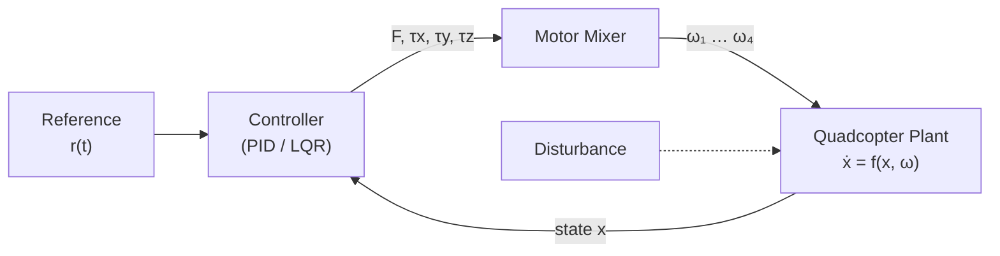

<div align="center">

# 🚁 Quadcopter Control

**Autonomous trajectory tracking for a quadcopter in 1D, 2D and 3D — PID vs. LQR, with a shared plant model and motor mixer.**


</div>

---

## Table of Contents

1. [Overview](#overview)
2. [Key Features](#key-features)
3. [System Architecture](#system-architecture)
4. [Repository Structure](#repository-structure)
5. [Getting Started](#getting-started)
6. [Plant Model](#plant-model)
7. [Motor Mixer](#motor-mixer)
8. [Controllers](#controllers)
   - [PID (Cascaded)](#1-pid-controller-proportional-integral-derivative)
   - [LQR](#2-lqr-controller-linear-quadratic-regulator)
9. [Comparison: PID vs LQR](#comparison-pid-vs-lqr)
10. [Evaluation Metrics](#evaluation-metrics)
11. [Assumptions & Limitations](#assumptions--limitations)
12. [Roadmap](#roadmap)
13. [References](#references)
14. [Contributing](#contributing)
15. [License](#license)

---

## Overview

This repository implements and benchmarks autonomous control systems for a quadcopter across **1D, 2D, and 3D** motion. The framework focuses on **precise trajectory tracking and position following**, and provides a common test bench for evaluating how each controller copes with:

- external disturbances,
- unmodeled dynamics,
- stability and actuator-effort requirements.

The project is built from three reusable blocks, which are the same for every experiment:

| Block | Role |
| :--- | :--- |
| **Plant** | Nonlinear 6-DOF rigid-body quadcopter dynamics. |
| **Controller** | PID or LQR, producing a desired total thrust and body torques. |
| **Motor Mixer** | Converts thrust/torques into individual motor speeds. |

---

## Key Features

- ✅ Nonlinear 6-DOF quadcopter plant driven directly by motor angular speeds
- ✅ Cascaded **PID** controller for position and attitude
- ✅ Full-state **LQR** controller solved through the Continuous Algebraic Riccati Equation
- ✅ Motor mixer with least-squares (normal equation) allocation
- ✅ 1D, 2D and 3D scenarios with plots and animated trajectory GIFs
- ✅ Side-by-side PID vs LQR benchmark

---

## System Architecture



The controller runs in closed loop with the full state `x`. The mixer is the only component that knows the physical motor layout, so controllers can be swapped without touching the plant.

---

## Repository Structure

> Adjust the names below so they match your actual files.

```text
quadcopter-control/
├── plant/                 # Nonlinear dynamics  ẋ = f(x, ω)
├── controllers/
│   ├── pid/               # Cascaded PID for 1D / 2D / 3D
│   └── lqr/               # LQR design (linearization + CARE) for 3D
├── mixer/                 # Motor mixer (wrench → ω²)
├── simulations/           # Scenario scripts, plots, GIF generation
├── docs/
│   ├── images/            # Figures and block diagrams
│   └── papers/            # Reference papers
├── requirements.txt
└── README.md
```

---

## Getting Started

### Prerequisites

- Python 3.9+
- `numpy`, `scipy`, `matplotlib` (plus `pillow` or `imageio` for GIF export)

### Installation

```bash
git clone https://github.com/<your-username>/<your-repo>.git
cd <your-repo>
python -m venv .venv
source .venv/bin/activate        # Windows: .venv\Scripts\activate
pip install -r requirements.txt
```

### Running a simulation

```bash
# Example entry points – rename to match your scripts
python simulations/run_pid_3d.py
python simulations/run_lqr_3d.py
python simulations/compare_pid_lqr.py
```

---

## Plant Model

### Aim

The plant computes the time derivative of the quadcopter state from its current state and the four motor angular speeds:

$$\dot{x} = f(x, \omega)$$

| Symbol | Meaning |
| :--- | :--- |
| $x = [x,\,y,\,z,\,\dot{x},\,\dot{y},\,\dot{z},\,\phi,\,\theta,\,\psi,\,p,\,q,\,r]^T$ | Position, translational velocity, Euler angles (roll, pitch, yaw), body angular rates |
| $\omega = [\omega_1,\,\omega_2,\,\omega_3,\,\omega_4]^T$ | Motor rotational speeds |

### Equations of motion

**Translational dynamics** (inertial frame, $z$ up, ZYX Euler convention, total thrust $F$):

$$
\begin{aligned}
\ddot{x} &= \frac{F}{m}\left(\cos\phi\sin\theta\cos\psi + \sin\phi\sin\psi\right)\\
\ddot{y} &= \frac{F}{m}\left(\cos\phi\sin\theta\sin\psi - \sin\phi\cos\psi\right)\\
\ddot{z} &= \frac{F}{m}\cos\phi\cos\theta - g
\end{aligned}
$$

**Euler-angle kinematics:**

$$
\begin{aligned}
\dot{\phi} &= p + q\sin\phi\tan\theta + r\cos\phi\tan\theta\\
\dot{\theta} &= q\cos\phi - r\sin\phi\\
\dot{\psi} &= \frac{q\sin\phi + r\cos\phi}{\cos\theta}
\end{aligned}
$$

**Rotational dynamics** (body frame, diagonal inertia, rotor gyroscopic terms neglected):

$$
\begin{aligned}
I_{xx}\dot{p} &= (I_{yy}-I_{zz})\,qr + \tau_x\\
I_{yy}\dot{q} &= (I_{zz}-I_{xx})\,pr + \tau_y\\
I_{zz}\dot{r} &= (I_{xx}-I_{yy})\,pq + \tau_z
\end{aligned}
$$

### Constant parameters

> 
>
> *Figure 1: Physical parameters (mass, moments of inertia, arm length, thrust/drag coefficients).*

---

## Motor Mixer

### Objective

The mixer is the interface between the high-level controller outputs — total thrust $F$ and torque vector $\tau = [\tau_x,\tau_y,\tau_z]^T$ — and the four physical actuators.

Each rotor produces thrust $k_f\omega_i^2$ and a drag torque $k_m\omega_i^2$, so the wrench is linear in the **squared** motor speeds:

$$\begin{bmatrix} F \\ \tau_x \\ \tau_y \\ \tau_z \end{bmatrix} = M \begin{bmatrix} \omega_1^2 \\ \omega_2^2 \\ \omega_3^2 \\ \omega_4^2 \end{bmatrix}$$

For a **plus (+) configuration** with arm length $L$ the allocation matrix is:

$$
M = \begin{bmatrix}
k_f & k_f & k_f & k_f\\
0 & L k_f & 0 & -L k_f\\
-L k_f & 0 & L k_f & 0\\
-k_m & k_m & -k_m & k_m
\end{bmatrix}
$$

> The signs depend on the motor numbering and spin directions. Replace $M$ with the matrix that matches your model.

### Allocation

The motor speeds are recovered with the **normal equation** (least-squares solution):

$$\omega^2 = (M^T M)^{-1} M^T \begin{bmatrix} F \\ \tau_x \\ \tau_y \\ \tau_z \end{bmatrix}$$

For a square, full-rank $M$ (4 motors, 4 commands) this reduces to $M^{-1}$; the least-squares form stays valid if the layout is extended later (e.g. hexacopter).

### Practical considerations

- **Non-negativity:** $\omega_i^2$ must be $\ge 0$ — clip the result before taking the square root.
- **Saturation:** clamp $\omega_i$ to $[\omega_{min},\,\omega_{max}]$ to model real motor limits.

---

## Controllers

### 1. PID Controller (Proportional-Integral-Derivative)

#### Theory

The PID controller uses the feedback error $e(t) = r(t) - y(t)$ and requires no explicit physical model of the quadcopter:

$$u(t) = K_p e(t) + K_i \int_{0}^{t} e(t')\,dt' + K_d \frac{de(t)}{dt}$$

| Term | Effect |
| :--- | :--- |
| **Proportional ($K_p$)** | Output proportional to the current error. Faster response and shorter rise time; too high causes overshoot and instability. |
| **Integral ($K_i$)** | Accumulates past error to remove **steady-state error**; too high causes windup. |
| **Derivative ($K_d$)** | Reacts to the error rate. Damps overshoot and improves **settling time**; amplifies sensor noise. |

#### Cascaded structure (3D)

The quadcopter is under-actuated (4 inputs, 6 DOF), so horizontal motion is produced by tilting the vehicle. The 3D PID therefore uses nested loops:

1. **Position loop (outer):** position error → desired accelerations $\ddot{x}_d,\ddot{y}_d,\ddot{z}_d$
2. **Attitude generation:** accelerations → desired angles and thrust (small-angle approximation)

$$
\phi_d = \frac{1}{g}\left(\ddot{x}_d\sin\psi - \ddot{y}_d\cos\psi\right),\quad
\theta_d = \frac{1}{g}\left(\ddot{x}_d\cos\psi + \ddot{y}_d\sin\psi\right),\quad
F = m\,(g + \ddot{z}_d)
$$

3. **Attitude loop (inner):** angle error → torques $\tau_x,\tau_y,\tau_z$ (typically 5–10× faster than the position loop)

> **Block Diagram**
>
> 
>
> *Figure 2: Closed-loop PID control architecture for quadcopter position and attitude tracking.*

#### Tuning guidelines

1. Start with $K_i = K_d = 0$ and raise $K_p$ until the response is fast but not oscillatory.
2. Add $K_d$ to damp the overshoot.
3. Add a small $K_i$ to remove steady-state error, with **anti-windup** (integrator clamping).
4. Tune the inner (attitude) loop first, then the outer (position) loop.

#### Results & Visualizations

##### 1D Quadcopter Control
| Simulation Plots | Dynamic Trajectory GIFs |
| :---: | :---: |
|  |  |

##### 2D Quadcopter Control
| Simulation Plots | Dynamic Trajectory GIFs |
| :---: | :---: |
|  |  |

##### 3D Quadcopter Control
| Simulation Plots | Dynamic Trajectory GIFs |
| :---: | :---: |
|  |  |

---

### 2. LQR Controller (Linear Quadratic Regulator)

#### Theory

LQR is an optimal control strategy for state-space systems $\dot{x} = Ax + Bu$. It computes the state-feedback gain $K$ that minimizes the quadratic cost:

$$J = \int_{0}^{\infty} \left( x^T Q x + u^T R u \right) dt$$

- $Q \ge 0$ — state weighting matrix (penalizes tracking error)
- $R > 0$ — control weighting matrix (penalizes actuator effort)

The optimal law and gain are:

$$u = -Kx, \qquad K = R^{-1} B^T P$$

where $P$ is the unique positive-definite solution of the **Continuous Algebraic Riccati Equation (CARE)**:

$$A^T P + P A - P B R^{-1} B^T P + Q = 0$$

#### Linearization about hover

The nonlinear plant is linearized around hover ($\phi,\theta,p,q,r \approx 0$, $F = mg$). With the error state $\tilde{x} = x - x_{ref}$ and input deviation $\tilde{u} = [F - mg,\ \tau_x,\ \tau_y,\ \tau_z]^T$, the translational and rotational dynamics decouple into:

$$
\ddot{x} \approx g\,\theta,\qquad
\ddot{y} \approx -g\,\phi,\qquad
\ddot{z} \approx \frac{\tilde{F}}{m},\qquad
\ddot{\phi} \approx \frac{\tau_x}{I_{xx}},\quad
\ddot{\theta} \approx \frac{\tau_y}{I_{yy}},\quad
\ddot{\psi} \approx \frac{\tau_z}{I_{zz}}
$$

The tracking law becomes $u = u_{hover} - K\,(x - x_{ref})$, and the resulting $\tau$ and $F$ go through the [motor mixer](#motor-mixer).

#### Choosing $Q$ and $R$

- Start with **Bryson's rule**: $Q_{ii} = 1/(\text{max acceptable } x_i)^2$, $R_{jj} = 1/(\text{max input } u_j)^2$.
- Increase $Q$ on position states for tighter tracking; increase $R$ for gentler, lower-energy motor commands.

#### Block Diagram

> 
>
> 
>
> *Figure 3: Optimal state-feedback LQR control architecture.*

#### Results & Visualizations

##### 3D Quadcopter Control
| Dynamic Trajectory GIF |
| :---: |
|  |

---

## Comparison: PID vs LQR

| Feature | PID Controller | LQR Controller |
| :--- | :--- | :--- |
| **Model dependency** | Model-free; no dynamics equations required. | Model-based; requires linear state-space matrices ($A$, $B$). |
| **Architecture** | Single-input single-output (SISO) loops tuned independently. | Multi-input multi-output (MIMO) full-state feedback. |
| **Tuning** | Heuristic / manual (risk of overshoot and actuator saturation). | Systematic trade-off of performance vs. control effort via $Q$ and $R$. |
| **Coupling handling** | Can struggle with strong coupling in 3D motions. | Inherently handles cross-coupling between translational and rotational axes. |
| **Optimality** | None guaranteed. | Optimal for the chosen quadratic cost (on the linearized model). |
| **Operating range** | Works across a wide range if gains are robust. | Best near the linearization point; degrades with aggressive maneuvers. |
| **Measurement needs** | Error and its derivative per loop. | Full state estimate. |

### Comparative Results


---

## Evaluation Metrics

Both controllers are compared with the same metrics, so results are reproducible and objective. Fill in the table from your simulation runs.

| Metric | Definition | PID | LQR |
| :--- | :--- | :---: | :---: |
| Rise time | Time to go from 10 % to 90 % of the step | — | — |
| Settling time | Time to stay within ±2 % of the target | — | — |
| Overshoot (%) | Peak excess over the target | — | — |
| Steady-state error | Final tracking error | — | — |
| RMS tracking error | $\sqrt{\frac{1}{T}\int \lVert e \rVert^2 dt}$ | — | — |
| Control effort | $\int \lVert \omega \rVert^2 dt$ | — | — |
| Disturbance rejection | Peak deviation and recovery time after a gust | — | — |

---

## Assumptions & Limitations

- Rigid-body vehicle with diagonal inertia tensor
- Rotor gyroscopic effects, blade flapping and aerodynamic drag are neglected
- Instantaneous motor response (no motor dynamics)
- Full-state feedback with no sensor noise or estimation delay
- LQR is designed on a hover linearization, so performance degrades at large tilt angles

---

## Roadmap

- [ ] Motor dynamics (first-order lag) and saturation modelling
- [ ] Sensor noise and a state estimator (Kalman / EKF)
- [ ] Integral action in LQR (LQI) for constant-disturbance rejection
- [ ] Model Predictive Control (MPC) for constrained tracking
- [ ] Aerodynamic drag and wind-gust disturbance models
- [ ] Trajectory generation (minimum-snap) for aggressive flight
- [ ] Hardware-in-the-loop / ROS 2 integration

---

## References

1. *ASCE Journal of Aerospace Engineering* paper — [ASCEAS.1943-5525.0001336.pdf](https://github.com/user-attachments/files/33455191/ASCEAS.1943-5525.0001336.1.pdf)
2. *Control Strategies for 6-DOF Quadcopter UAVs: Cascade PID Stabilization* — [PDF](https://github.com/user-attachments/files/33455142/Control.Strategies.for.6-DOF.Quadcopter.UAVs_.Cascade.PID.Stabili.1.pdf)

---

## Contributing

Contributions are welcome.

1. Fork the repository
2. Create a feature branch: `git checkout -b feature/my-improvement`
3. Commit your changes: `git commit -m "Add my improvement"`
4. Push the branch and open a pull request

---

## License

Distributed under the MIT License. See `LICENSE` for details.

---

<div align="center">

If you find this project useful, consider giving it a ⭐

</div>
