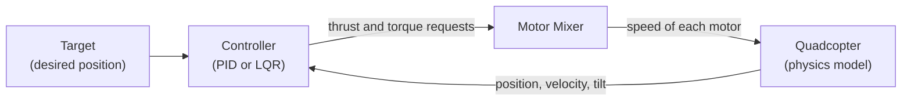

<div align="center">


<br>

# Quadcopter Control & 6-DOF Flight Simulation

**Teaching a quadcopter to fly itself: modelling, control and simulation in Python**

<br>


<br>

[Overview](#overview) •
[Demo](#demo) •
[How It Works](#how-it-works) •
[Getting Started](#getting-started) •
[Simulations](#simulation-levels) •
[Controllers](#the-two-controllers) •
[Comparison](#pid-vs-lqr) •
[References](#references)

</div>

---

## Overview

A quadcopter is naturally unstable. Left alone, it tips over and falls within moments. It stays in the air only because a controller continuously measures what the vehicle is doing and adjusts the speed of four motors, many times per second.

This project builds that entire loop in software. It contains a physics-based model of a quadcopter, two different controllers that fly it, and tools to plot and animate the results. The two controllers are:

- **PID**, the classic, widely used feedback controller.
- **LQR**, a more systematic controller that is designed from a model of the vehicle.

Both are tested on the same quadcopter and the same flight tasks, so their behaviour can be compared fairly.

### Project goals

- Build a working physical model of a quadcopter.
- Fly it with both a PID and an LQR controller.
- Grow step by step from simple up-and-down motion (1D) to full 3D flight.
- Show how motor commands are produced from high-level control decisions.
- Compare the two controllers through clear plots and animations.

---

## Demo

The animation below shows the quadcopter following a trajectory under both controllers.

<div align="center">


</div>

---

## How It Works

Every simulation in this repository follows the same control loop. The quadcopter's current state is measured, compared with where it should be, and turned into motor commands that move it closer to the target.



| Stage | What it does |
|:---|:---|
| **Target** | Defines where the quadcopter should be, such as a hover point or a path. |
| **Controller** | Decides how much total lift and how much turning force are needed to get there. |
| **Motor Mixer** | Translates those requests into a speed for each of the four motors. |
| **Quadcopter model** | Simulates how the vehicle moves in response, then reports its new state back to the controller. |

---

## Getting Started

### Requirements

- Python 3.9 or newer
- The packages listed in `requirements.txt`

### Installation

```bash
git clone <your-repository-url>
cd QUADCOPTER_CONTROL
pip install -r requirements.txt
```

### Running a simulation

Open the folder for the level you want (`1D`, `2D` or `3D`) and run the script for the controller of your choice.

```bash
cd 3D

python main_pid.py    # fly with the PID controller
python main_lqr.py    # fly with the LQR controller
```

Each run produces performance plots and a trajectory animation.

---

## Repository Structure

The project is split into three folders, one for each simulation level. Every folder follows the same layout, which makes it easy to move from one level to the next.

```text
QUADCOPTER_CONTROL/
│
├── 1D/                     Vertical flight (altitude only)
│   ├── main_pid.py
│   ├── main_lqr.py
│   ├── plot.py
│   ├── animation.py
│   ├── PID/z_pid.py
│   └── LQR/z_lqr.py
│
├── 2D/                     Planar flight (forward and up)
│   ├── main_pid.py
│   ├── main_lqr.py
│   ├── plot.py
│   ├── animation.py
│   ├── PID/xz_pid.py
│   └── LQR/xz_lqr.py
│
├── 3D/                     Full spatial flight
│   ├── main_pid.py
│   ├── main_lqr.py
│   ├── plot.py
│   ├── animation.py
│   ├── PID/xyz_pid.py
│   └── LQR/xyz_lqr.py
│
├── README.md
└── requirements.txt
```

| File | Purpose |
|:---|:---|
| `main_pid.py` | Runs the simulation with the PID controller. |
| `main_lqr.py` | Runs the simulation with the LQR controller. |
| `plot.py` | Creates the result plots. |
| `animation.py` | Creates the flight animations. |
| `PID/` | Contains the PID controller for that level. |
| `LQR/` | Contains the LQR controller for that level. |

---

## Simulation Levels

The project builds up in three stages. Each stage adds one new idea on top of the previous one.

| Level | Controlled motion | New idea introduced |
|:---:|:---|:---|
| **1D** | Altitude (Z) | Basic lift and stabilization |
| **2D** | Forward position (X) and altitude (Z) | Tilting the vehicle to move sideways |
| **3D** | Full position (X, Y, Z) and orientation | Roll, pitch and yaw working together |

### 1D: Vertical Flight

The simplest case. The quadcopter can only move up and down, so the controller has one job: reach the target height and hold it. This stage introduces the core ideas of lift, weight and stabilization without any added complexity.

**Code:** [`1D/PID/z_pid.py`](1D/PID/z_pid.py) • [`1D/LQR/z_lqr.py`](1D/LQR/z_lqr.py)

<div align="center">

| PID Plot | PID Animation |
|:---:|:---:|
|  |  |

</div>

### 2D: Planar Flight

Here the quadcopter moves forward and up. A quadcopter cannot push itself sideways directly. It must first **tilt**, so that part of its lift points in the direction of travel. The controller therefore manages three things together: horizontal position, altitude and tilt angle.

**Code:** [`2D/PID/xz_pid.py`](2D/PID/xz_pid.py) • [`2D/LQR/xz_lqr.py`](2D/LQR/xz_lqr.py)

<div align="center">

| PID Plot | PID Animation |
|:---:|:---:|
|  |  |

</div>

### 3D: Full Spatial Flight

The complete problem. The quadcopter moves freely in all three directions and controls how it is oriented, including roll, pitch and yaw (turning on the spot). Position and orientation are tightly linked, which is what makes this level the most demanding and the most realistic.

**Code:** [`3D/PID/xyz_pid.py`](3D/PID/xyz_pid.py) • [`3D/LQR/xyz_lqr.py`](3D/LQR/xyz_lqr.py)

**PID results**

<div align="center">

| PID Plot | PID Animation |
|:---:|:---:|
|  |  |

</div>

**LQR results**

<div align="center">


</div>

---

## Under the Hood

### The quadcopter model

The simulated vehicle is described by twelve numbers that fully define its condition at any instant. The model takes these numbers together with the four motor speeds and works out how the vehicle will move next.

| Group | What it describes | Variables |
|:---|:---|:---|
| **Position** | Where the vehicle is | X, Y, Z |
| **Velocity** | How fast it is moving | Speed along X, Y, Z |
| **Orientation** | How it is tilted and facing | Roll, Pitch, Yaw |
| **Rotation rate** | How fast it is turning | P, Q, R |

The model also accounts for the vehicle's mass, its resistance to rotation (moments of inertia), arm length, and the thrust and drag produced by the propellers.

<div align="center">


*Figure 1. Physical parameters and governing equations of the quadcopter model.*

</div>

### The motor mixer

A controller thinks in terms of what the vehicle needs: *"more lift"* or *"tilt forward a little"*. The motors, however, only understand speeds. The motor mixer is the translator between the two.

It takes four requests from the controller:

- one for total lift
- one for each of the three turning directions (roll, pitch and yaw)

and converts them into a speed for each of the four motors. For example, to tilt forward, the mixer speeds up the rear motors and slows down the front ones. This keeps the controller simple and independent of the motor layout.

---

## The Two Controllers

### PID Controller

PID is the most widely used controller in engineering. It looks at the **error**, the gap between where the vehicle is and where it should be, and reacts in three ways:

| Part | Question it answers | Effect |
|:---:|:---|:---|
| **P** (Proportional) | How far off are we right now? | Pushes harder when the error is large. |
| **I** (Integral) | Have we been off for a long time? | Removes small errors that would otherwise remain. |
| **D** (Derivative) | How quickly is the error changing? | Smooths the motion and prevents overshoot. |

In this project, PID loops are layered: an outer loop decides how the vehicle should tilt to reach its target, and an inner loop adjusts the motors to achieve that tilt.

<div align="center">


*Figure 2. Closed-loop PID control architecture for position and attitude tracking.*

</div>

### LQR Controller

LQR (Linear Quadratic Regulator) takes a different approach. Instead of tuning each loop by hand, it uses a simplified model of the vehicle to calculate the best possible feedback settings automatically.

The engineer only states what matters more:

- **Accuracy:** how strongly deviations from the target should be penalized.
- **Effort:** how costly it is to use the motors aggressively.

LQR then finds the best balance between the two. It looks at **all states at once**, which suits a quadcopter well because its position, tilt and rotation all affect each other.

<div align="center">


<br><br>


*Figure 3. Optimal state-feedback LQR control architecture.*

</div>

---

## PID vs LQR

Both controllers are evaluated inside the same simulation framework, so differences come from the control strategy and not from the setup.

| | **PID** | **LQR** |
|:---|:---|:---|
| **Needs a vehicle model?** | Not required to get started. | Yes, a simplified model is needed. |
| **How it is tuned** | Gains are adjusted by hand or by trial and error. | Chosen through accuracy and effort preferences. |
| **Handling of coupled motion** | Each loop works separately, so strong coupling is harder to manage. | Considers all states together. |
| **Optimality** | No guarantee of the best response. | Best response for the chosen preferences and model. |
| **Best suited for** | Quick setup and hands-on tuning. | Systematic design of multi-axis control. |

### Results

**Trajectory tracking**

<div align="center">


</div>

**Dynamic response**

<div align="center">


</div>

---

## References

The methods in this project are based on the following research:

1. [ASCEAS.1943-5525.0001336: research paper](https://github.com/user-attachments/files/33455191/ASCEAS.1943-5525.0001336.1.pdf)
2. [Control Strategies for 6-DOF Quadcopter UAVs: Cascade PID Stabilization](https://github.com/user-attachments/files/33455142/Control.Strategies.for.6-DOF.Quadcopter.UAVs_.Cascade.PID.Stabili.1.pdf)

---

<div align="center">

**Quadcopter Control** • 6-DOF Dynamics • PID • LQR • 3D Trajectory Tracking

*Exploring autonomous flight through modelling, control theory and simulation.*

</div>
